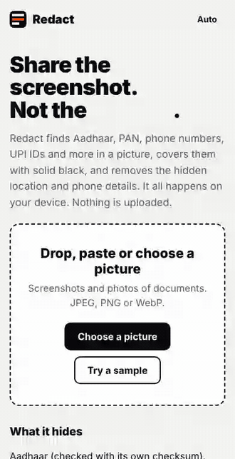

<div align="center">

# Redact

**Hide the personal details in a screenshot or photo before you share it.**

Finds Aadhaar, PAN, phone numbers, UPI IDs, bank accounts and more, then paints them solid black.
Everything happens on your device. Nothing is uploaded, ever.

[](https://github.com/jay-m007/Redact/actions/workflows/test.yml)
[](LICENSE)


### [Try it now → jay-m007.github.io/Redact](https://jay-m007.github.io/Redact/)



</div>

## Why

People post payment screenshots, ID photos and chat screenshots every day. Phone numbers, Aadhaar numbers and UPI IDs sit right there in the picture. Most "redact" websites ask you to upload the very picture you are trying to protect.

Redact does the opposite. The page runs on your phone or laptop. Nothing is sent anywhere, and the app opens offline after your first visit.

## How it works

1. **Pick a picture.** Choose, drop or paste a screenshot or photo.
2. **Tap "Find personal details".** The text is read on your device and checked against 15 kinds of detail.
3. **Check the boxes.** Drag to add a black box. Tap a box to remove it.
4. **Save.** You get a new picture with solid black over each box, and none of the hidden photo data.

## What it finds

Aadhaar, PAN, phone numbers, email addresses, UPI IDs, card numbers, bank account numbers, IFSC codes, dates of birth, names after a label, OTPs and codes, vehicle numbers, passport numbers, Voter ID and driving licences.

It does not just match digits. Aadhaar and card numbers are checked with their check digits (Verhoeff and Luhn), so ordinary numbers like an order ID are left alone.

It also shows what a photo is hiding: phone model, time taken and GPS location. The saved file carries none of it.

## Privacy, in a way you can check

- The page has a strict Content-Security-Policy: it may only load from its own address. The browser itself blocks any request elsewhere.
- No analytics, no cookies, no accounts, no fonts or scripts from other sites.
- The only thing stored in your browser is your light or dark choice.
- The picture is rebuilt from scratch when you save, so the black boxes are real pixels, not a layer that can be peeled off. The tests open the saved file and check every pixel inside the boxes is black.

## Be honest about the limits

- **Reading text from a picture is not perfect.** It can miss blurry or tiny text. Always look at the result before you share it, and add boxes by hand where needed.
- Names and addresses are found only when a label like "Name:" is next to them. A name on its own line is not detected.
- Pictures only. PDFs are not supported yet.
- Photo data (EXIF) is read for JPEG files. Saving always strips it.
- It paints solid black, not blur. Blur can sometimes be undone, black cannot.
- English text only for now.

## Run it yourself

```
npm install
npm test
npm run serve        # http://localhost:8080
```

No framework and no bundler. Under 1,000 lines of plain JavaScript, plus the open-source text reader ([tesseract.js](https://github.com/naptha/tesseract.js), see [THIRD-PARTY.md](THIRD-PARTY.md)).

## Contribute

The most useful thing you can add is a new detector: another kind of detail, or a better way to catch one. See [CONTRIBUTING.md](CONTRIBUTING.md). Use made-up test data only.

If Redact saved you from posting something you should not have, a star helps other people find it.

## Licence

MIT. Made by [Jay Maurya](https://github.com/jay-m007).
